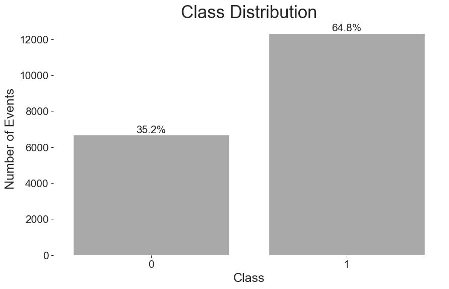
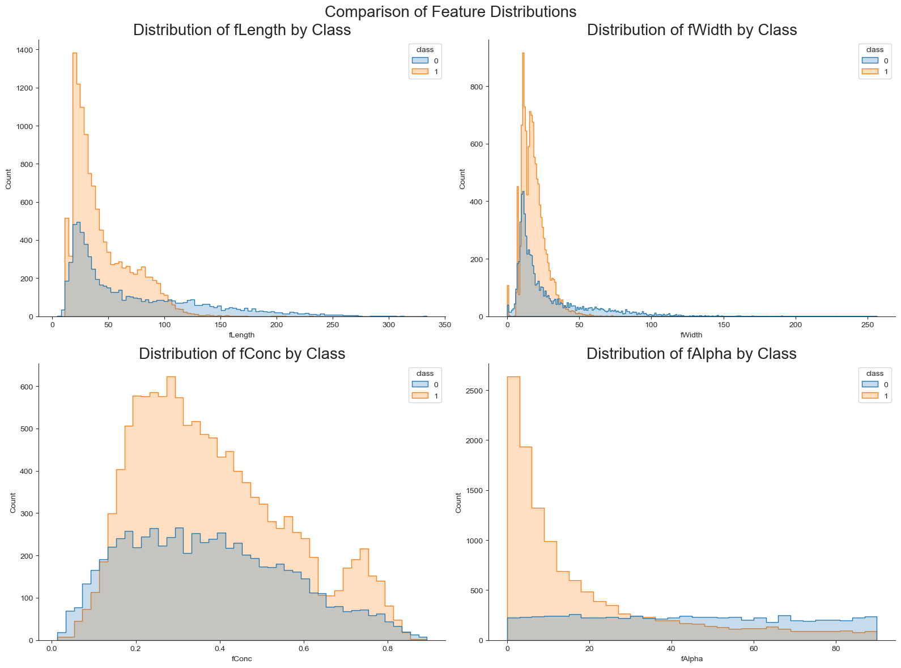
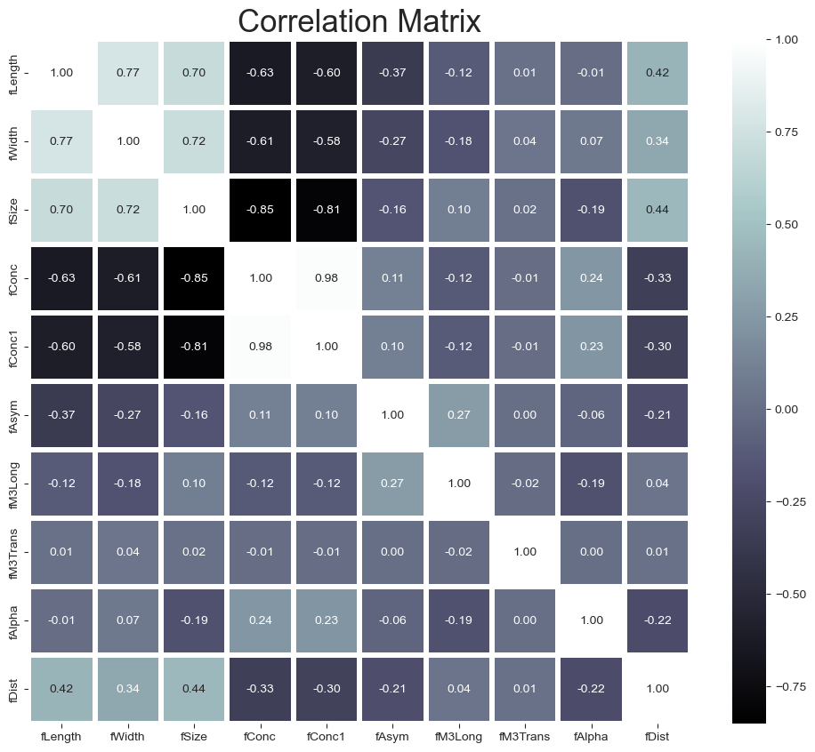

# Gamma-Ray vs Hadron Classification (MAGIC Telescope)

Classifies MAGIC Gamma Telescope events as gamma-ray signals or hadronic background. A tuned XGBoost model reaches 86.6% test accuracy and beats a Keras MLP on the same split.

## Results

Held-out test set: 2,853 events (1,850 gamma, 1,003 hadron). Numbers are the final summary table in `gamma.ipynb` (cell 61).

| Model | Accuracy | AUC | F1 (gamma) | Recall (gamma) |
|---|---|---|---|---|
| **XGBoost (tuned, baseline)** | **86.6%** | **0.838** | **0.900** | 0.932 |
| Keras MLP | 83.2% | 0.779 | 0.880 | **0.956** |

XGBoost is more accurate and has a higher AUC. The MLP finds more gamma events (higher recall) but labels more hadron events as gamma.

## Problem

The telescope records gamma-ray events and hadronic events. Hadronic events are background: they carry no useful information for the science. The task is to separate the two classes from the image parameters recorded for each event, so that only the gamma-ray events go on to analysis.

## Data

- **Source:** [MAGIC Gamma Telescope dataset](https://archive.ics.uci.edu/dataset/159/magic+gamma+telescope), UCI Machine Learning Repository (id 159). The notebook downloads it with the `ucimlrepo` package at run time, so it needs internet access.
- **Size:** 19,020 events, 10 continuous features (for example `fLength`, `fWidth`, `fAlpha`), one binary label (`g` = gamma, `h` = hadron). No missing values.
- **Class balance:** about 65% gamma and 35% hadron (`figs/fig1.png`).
- **Split:** stratified 70 / 15 / 15 with `random_state=56`: 13,314 train, 2,853 validation, 2,853 test.

## Approach

- **XGBoost baseline:** `XGBClassifier` with `binary:logistic`. Hyperparameters tuned with `RandomizedSearchCV` (25 candidates from a 729-combination grid, 3-fold CV on the training split, scored by ROC AUC). Best settings in the notebook: learning rate 0.1, max depth 5, 200 trees, `colsample_bytree` 0.8, `gamma` 0.1.
- **Keras MLP:** 10 inputs, then Dense layers of 64, 32 and 16 units with ReLU, L2 penalty 0.001 and dropout (0.24, 0.34, 0.34), and a sigmoid output. 3,329 trainable parameters. Adam, binary cross-entropy, batch size 64, up to 300 epochs.
- **Early stopping:** the MLP stops on validation loss (patience 30) and restores the best weights.
- **Same evaluation for both:** both models are scored on the same test set, with a 0.5 decision threshold.
- **Scaling:** a `StandardScaler` step is in the notebook but commented out. The notebook notes that scaling does not always work with XGBoost and `RandomizedSearchCV`.

## Figures

Exploratory figures from the notebook:







## Repo contents

| Path | Description |
|------|-------------|
| `gamma.ipynb` | The full analysis: data loading, EDA, XGBoost tuning, Keras MLP, comparison. Cells include saved outputs. |
| `figs/` | Figure exports. `fig1`–`fig3` are used above. `fig7` is the Keras MLP model summary (3,329 parameters, 64/32/16/1 units), which matches the final architecture. `fig8` is a classification report (accuracy 0.84) from an earlier run and matches neither final model. `fig4`–`fig6`, `fig9` and `fig10` are also from earlier runs and do not match the final outputs (see Limitations). |
| `requirements.txt` | Pinned Python dependencies (pandas, scikit-learn, xgboost, tensorflow, keras, ucimlrepo, etc.). |
| `README.md` | This file. |

## How to run

The project is a single Jupyter notebook. There are no scripts and no tests.

```bash
git clone https://github.com/EFaridRahimli/M516-Submission
cd M516-Submission
conda create -n gamma python=3.10 && conda activate gamma
conda install -c conda-forge tensorflow   # recommended over pip for TensorFlow
pip install -r requirements.txt
jupyter notebook gamma.ipynb
```

Run the notebook from top to bottom. `requirements.txt` includes two Windows-only packages, `pywin32` and `pywinpty`. On Linux or macOS, remove those two lines before running `pip install -r requirements.txt`.

## Limitations and next steps

- **One split, one seed.** The table comes from a single stratified split with `random_state=56`. The gap between the two models is not tested across seeds or folds.
- **Mixed runs in `figs/`.** Several figures (`fig4`–`fig6`, `fig8`, `fig9`, `fig10`) show different numbers from the final table, for example 85.3% XGBoost accuracy. Rerunning the notebook regenerates the outputs.
- **No written conclusion in the notebook.** The notebook ends with a plot. The comparison above is the conclusion.
- **Next steps:** repeat the split with several seeds or use repeated cross-validation to report a mean and spread. Tune the decision threshold to trade gamma recall against hadron precision.

Coursework for M516, MSc Business Project in Big Data & AI.
